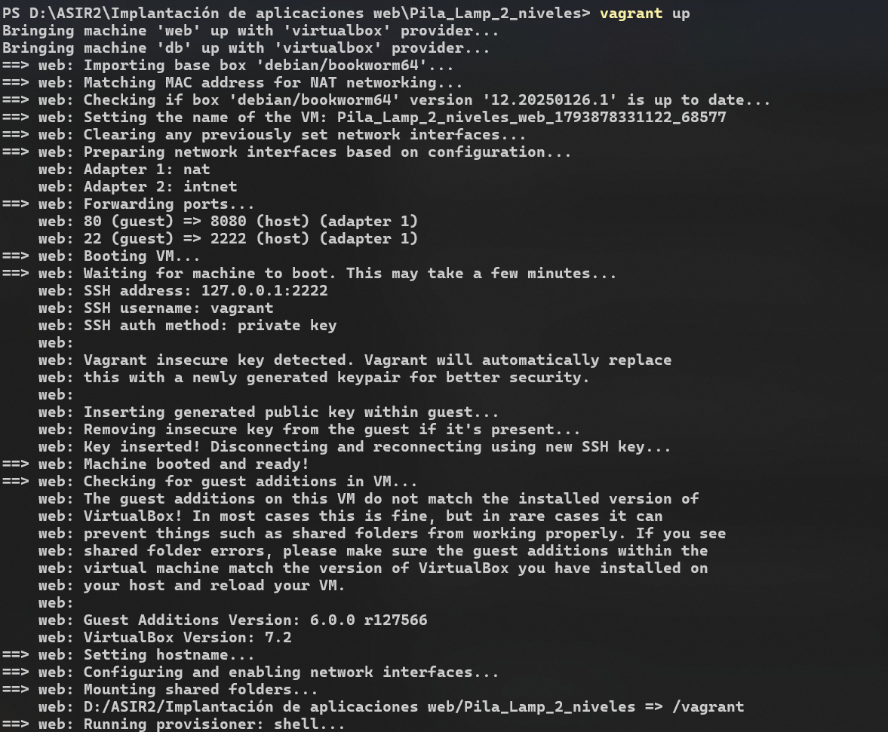
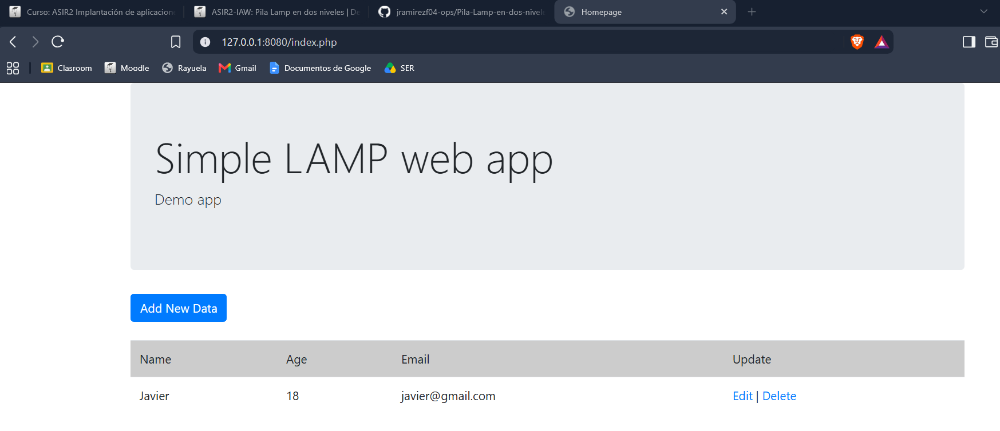

# Pila-Lamp-en-dos-niveles

## 1. Introducción y Arquitectura (CC1)
El objetivo de esta práctica es desplegar una aplicación web separando la infraestructura en dos niveles para mejorar la seguridad.

*   **Servidor Web (Apache/PHP):** Tiene salida a Internet mediante NAT para descargar paquetes y está expuesto al anfitrión mediante reenvío de puertos (8080 -> 80).
*   **Servidor de Base de Datos (MariaDB):** Completamente aislado de Internet. Solo se comunica con el servidor web a través de una red interna privada.

### Esquema de red
* **1. Tu PC (Anfitrión):** Accede a la aplicación desde el navegador a través de `localhost:8080`.
* **2. Servidor Web (IP 192.168.50.10):** Recibe tu petición y se comunica por una red privada con la base de datos.
* **3. Servidor de Base de Datos (IP 192.168.50.20):** Almacena la información. Está totalmente aislado de Internet por seguridad.


## 2. Demostración de Funcionamiento (CC5)

En el siguiente enlace se puede ver un screencast demostrando el correcto funcionamiento de la aplicación, añadiendo un usuario que se guarda en la base de datos aislada:
**https://drive.google.com/file/d/1QGe3ys1O0aHaB-FDurGEURpmQoJcXLLx/view?usp=sharing**

### Capturas del entorno corriendo:




## 3. Configuración del Entorno (Vagrantfile)
Se ha utilizado un único `Vagrantfile` para definir y orquestar ambas máquinas simultáneamente sobre la distribución Debian 12.

```ruby
Vagrant.configure("2") do |config|
  config.vm.box = "debian/bookworm64"

  # MÁQUINA 1: SERVIDOR WEB (Frontend)
  config.vm.define "web" do |web|
    web.vm.hostname = "JavierApache"
    web.vm.network "private_network", ip: "192.168.50.10", virtualbox__intnet: "red_backend"
    web.vm.network "forwarded_port", guest: 80, host: 8080, host_ip: "127.0.0.1"
    web.vm.provision "shell", path: "instalar_web.sh"
  end

  # MÁQUINA 2: BASE DE DATOS (Backend)
  config.vm.define "db" do |db|
    db.vm.hostname = "JavierMysql"
    db.vm.network "private_network", ip: "192.168.50.20", virtualbox__intnet: "red_backend"
    db.vm.provision "shell", path: "instalar_db.sh"
  end
end
```

## 4. Aprovisionamiento y Ajustes Automáticos (CC2 y CC4)

### Servidor Web (`instalar_web.sh`)
Se instala Apache, PHP, Git y se clona la aplicación. Para automatizar la conexión con el servidor de base de datos **(Criterio CC4)**, se utiliza el comando `sed` sustituyendo los valores genéricos de `config.php` por la IP privada de la máquina aislada (`192.168.50.20`):

```bash
sed -i "s/'localhost'/'192.168.50.20'/" /var/www/html/config.php
sed -i "s/'database_name_here'/'lamp_db'/" /var/www/html/config.php
sed -i "s/'username_here'/'lamp_user'/" /var/www/html/config.php
sed -i "s/'password_here'/'lamp_password'/" /var/www/html/config.php
```

